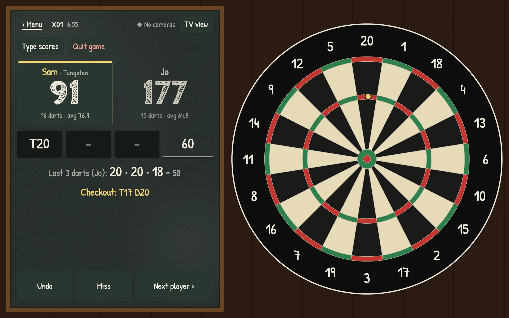
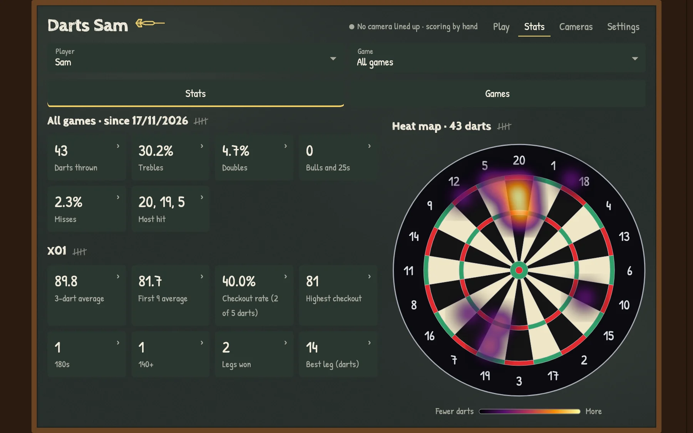
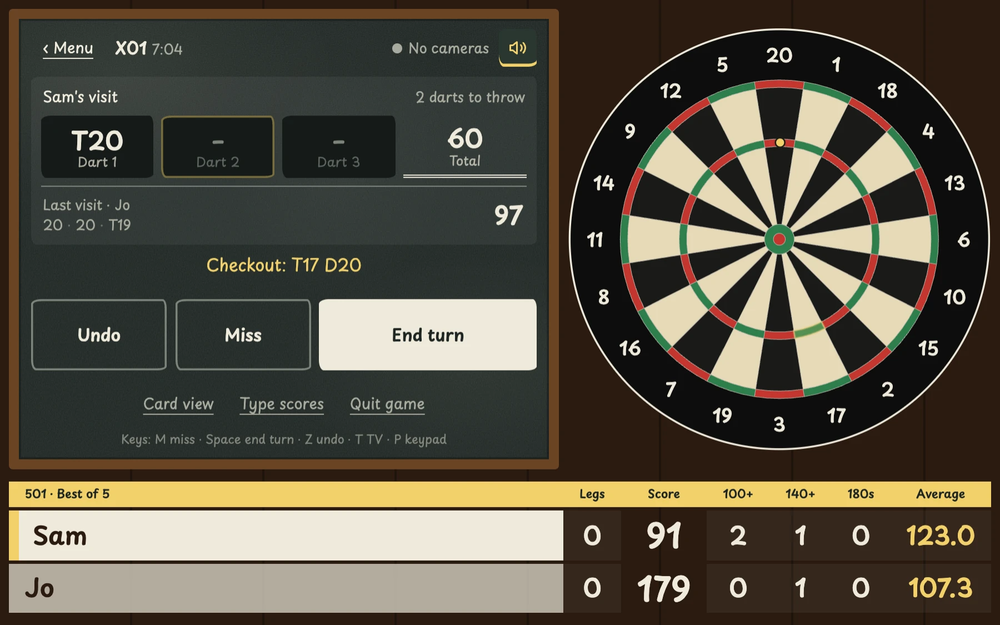
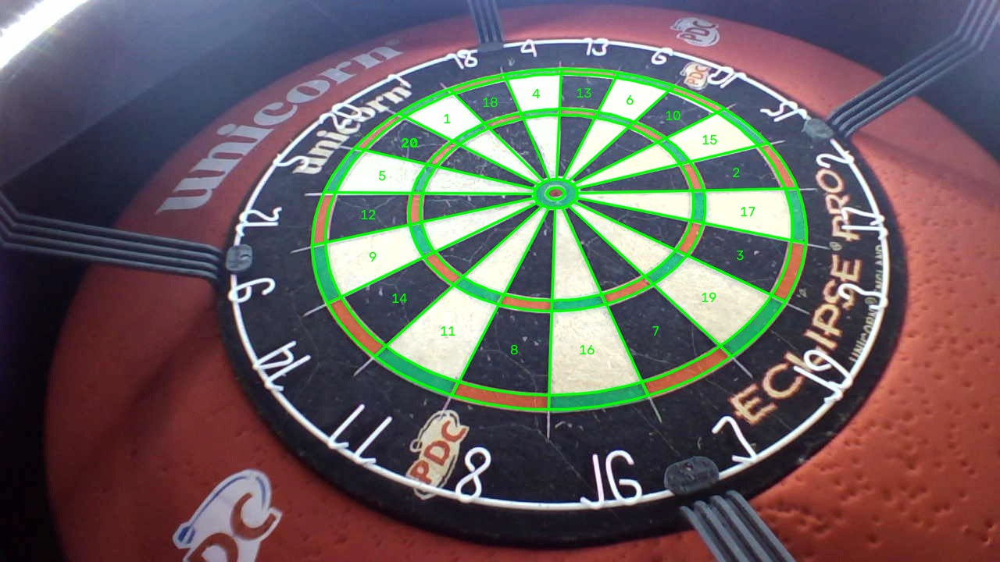

# Darts S.A.M

**S**coring **A**ssisted **M**arker: a darts scoreboard that scores by itself.
Point two or three cheap webcams at the board and it sees where each dart
lands. No cameras? Tap the board instead. Free, with no adverts, and open
source.

[](https://github.com/SonicSamShop/darts-sam/actions/workflows/tests.yml)
[](LICENSE)



**[Play in a browser](https://dartssam.co.uk)** ·
**[Download the app](https://dartssam.co.uk/download.html)** (Mac, Windows, Linux) ·
**[Run it from the code](#run-it-from-the-code)**

## What it does

- **Scores by camera.** USB webcams round the board watch for each dart, work
  out the segment, and move on to the next player when the darts are pulled.
  Or, in Beta, [your phone's own camera](docs/using.md#scoring-with-your-phones-camera-beta)
  on the site: no computer, and it asks when it isn't sure.
- **Finds the board by itself.** No stickers, no markers, no clicking round the
  wires: [one tap per camera, once](#the-cameras-find-the-board-by-themselves).
- **Eight games:** X01 (legs and sets), Cricket, Around the Clock, Count Up,
  121 Checkout, Killer, Random Targets and Free Mode. A game is one small
  file, so [adding one](CONTRIBUTING.md#adding-a-game) is easy.
- **Stats worth having.** The figures the PDC publishes for its matches
  (three-dart and first-nine averages, checkout rate, 180s), a heat map of
  where your darts land, and every number opens up into the legs behind it.
- **Any screen.** A phone at the oche, a tablet on the wall, or the TV with
  the scores along the bottom. It installs to the home screen and keeps
  working with no network.
- **Calls the score** when sound is on: the visit's total and what you
  require, and every dart if you like.
- **Yours.** At home it keeps your players, games and every dart in one file
  on your own computer.
  It sends nothing anywhere unless you connect it to an account or agree to
  share; the desktop app only asks, when it starts, whether there is a newer
  version.

| | |
|---|---|
|  |  |

## The cameras find the board by themselves

Before a camera can score, it has to know where the board is in its picture.
The simple ways to tell it are markers stuck round the board, or someone
clicking on wire crossings in every camera's picture, where any slip of the
finger goes straight into every score. Darts S.A.M reads the board itself: it
finds the red and green rings, measures the 40 places where a red block meets
a green one, fits the board to all of them, and measures how much the lens
bends the picture while it is at it.



In simulation it lands within 0.2 mm everywhere on the board, where four taps
a couple of pixels out are 5 to 14 mm off at the worst point.
**[How the cameras find the board](docs/calibration.md)** explains every step
with pictures, and how to use it in a project of your own. To try it on a
picture, from the code's folder, with nothing else running:

```bash
pip install opencv-python-headless numpy
python -m server.autocalib docs/img/calibration/real.jpg --twenty 530,183 --out found.jpg
```

That picture came from a webcam on the light ring; `--twenty` is any pixel in
the 20, to say which way up the board is.

## Three ways to use it

**In a browser.** [dartssam.co.uk](https://dartssam.co.uk): sign in and play,
on anything. Your players, games and stats follow you to every device.

**The desktop app**, for the computer your cameras plug into: a
[download](https://dartssam.co.uk/download.html) for Mac, Windows or Linux
with nothing else to install. Use it by itself, or connect it to your account
on the site with a 6-letter code, so every screen you sign in on scores by
itself.

### Run it from the code

On a Raspberry Pi, or any computer with Python 3.11 or newer:

```bash
git clone https://github.com/SonicSamShop/darts-sam.git && cd darts-sam
python3 -m venv .venv && .venv/bin/pip install -r requirements.txt
.venv/bin/python -m server.app
```

Then open `http://localhost:8000` (from another device, the computer's name or
address, such as `http://raspberrypi.local:8000`). It finds the USB cameras
that are plugged in, and runs happily with none.
[docs/setup.md](docs/setup.md) has the hardware to buy and the rest.

## Documentation

| | |
|---|---|
| [Setting it up at home](docs/setup.md) | The cameras and computer to buy, installing on a Raspberry Pi, the desktop apps, calibrating, using your cameras with the website. |
| [Using the app](docs/using.md) | Players, stats, what happens when a dart is scored wrongly, backing up. |
| [How the cameras find the board](docs/calibration.md) | The automatic calibration, step by step, and using it by itself. |
| [How a dart is found](docs/detection.md) | From a camera's picture to "treble 20", problem reports, and the numbers to tune. |
| [How the code is laid out](docs/architecture.md) | Which file does what, and how a dart gets to the screen. |
| [Running the hosted site](docs/hosting.md) | A site of your own: a server from nothing to running, backups, the admin pages. |
| [Releasing a new version](docs/releasing.md) | Version numbers, the builds, signed updates. |
| [Contributing](CONTRIBUTING.md) | Getting it running, the tests, how the code is written. |

## Status and known limits

**Tested:** game rules (unit tests), the app's screens in a browser, the
WebSocket link, and the camera code in simulation: 120 of 120 simulated darts
scored correctly, 0.4 mm from the truth on average, and the board found within
0.2 mm from seven camera positions (`python -m tests.test_vision` and
`python -m tests.test_calib` print the numbers).

**On real cameras:** it runs on a real three-camera rig. Finding the board
worked on every one of 30 pictures from it, one of which is the picture above
([the numbers](docs/calibration.md#how-good-is-it)). Scoring darts works, but
real wires, shadows and flights still fool it now and then: expect to tune it
on your own board ([what to tune](docs/detection.md#tuning)), and please
[send what goes wrong](CONTRIBUTING.md#what-helps-most).

- Finding the board needs an empty board, the whole double ring in view, and
  rings that are red and green.
- The lens's bend is measured when the board is found by itself. A camera
  marked by hand (four taps) is not corrected for it.
- A dart only one camera can see (hidden behind earlier darts from the others)
  is not scored: tap it in on the board.
- Bounce-outs are not detected (press Miss).
- Stats count every dart saved, those of a game still in progress included. A
  game ended with **Quit game** is thrown away, darts and all.
- X01 is double out; its checkout hints follow the standard published chart.
- With **Sound** on (Settings › In a game; off to begin with), scores are called
  in the device's own voice: each visit's total, and each dart as well if **Call
  each dart** is on. A device with no voice (a Pi, most Linux PCs) stays quiet.

**Not yet tried:** the Windows app on a real PC, and real USB cameras on
Windows; real USB cameras with the Linux app; a build signed by Apple; and
Sign in with Apple on the hosted site.

## Contributing

Bug reports, pictures from your own board, fixes and new games are all
welcome: [CONTRIBUTING.md](CONTRIBUTING.md) says how, and
[SECURITY.md](SECURITY.md) how to report a security problem privately.

## Licence and credit

Darts S.A.M is free software under the
[GNU Affero General Public License v3.0](LICENSE). You may use, change and
share it, including running it as a website, as long as:

- you keep the copyright and licence notices, and say clearly that your version
  is based on Darts S.A.M by Sam Cramphorn (https://github.com/SonicSamShop/darts-sam);
- anything you build from it, or run for other people over a network, is
  released under the same licence with its source code available to them.

"Darts S.A.M" and dartssam.co.uk are not covered by the licence. A changed
version must go out under a different name and must not suggest it is the
official app. The exact terms are in [LICENSE](LICENSE) and [NOTICE](NOTICE).

The fonts in `web/fonts/` are by their own authors, under the SIL Open Font
License (Special Elite: Apache License 2.0). Each one's licence is in
`web/fonts/licences/`.

Contributions are welcome: open an issue or a pull request. By sending a pull
request you agree to the [contribution terms](CONTRIBUTING.md#licence): it is
released under the same licence, and Sam Cramphorn may also release it under
other terms, which is what lets the app be published in the app stores.
