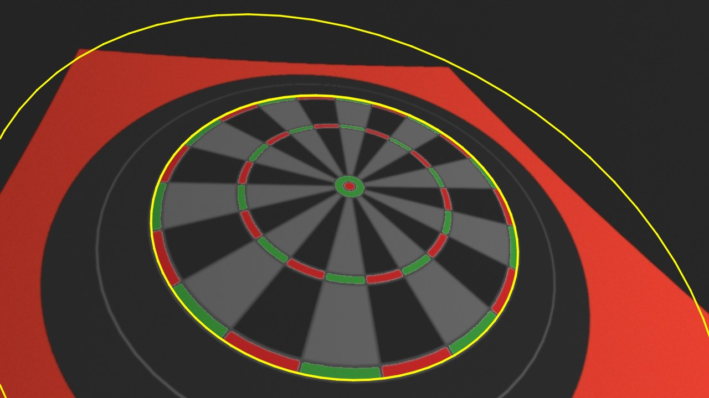
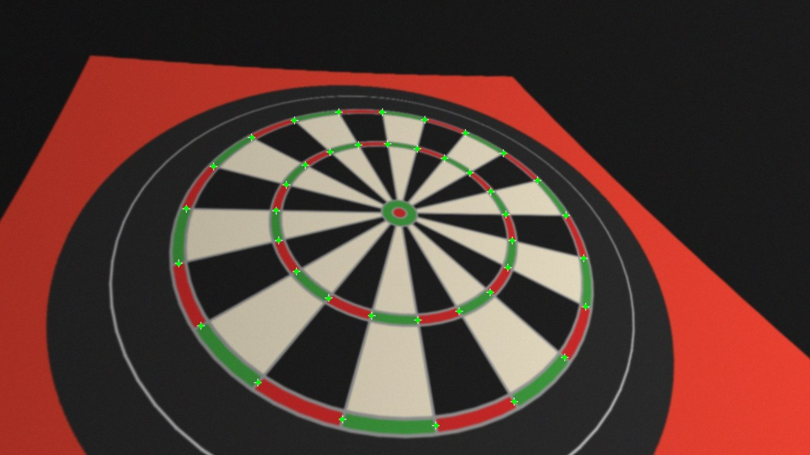
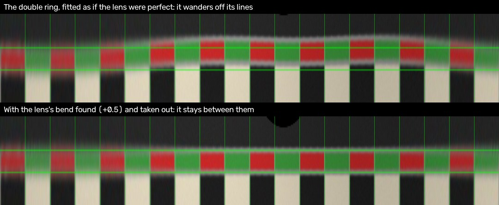
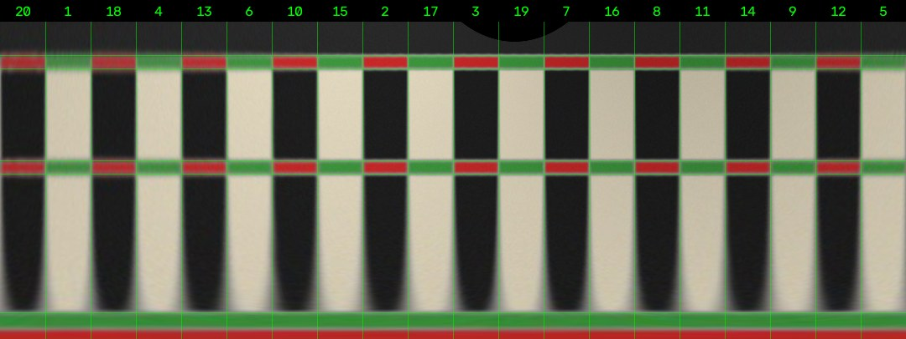

# How the cameras find the board

Before a camera can score a dart it has to know where the board is in its
picture: which pixel is the bull, where each wire runs. The simple ways to
tell it are stickers or printed markers round the board, or someone clicking
on wire crossings in every camera's picture, where any slip of the finger
goes straight into every score.

Darts S.A.M works it out from the board itself. It finds the red and green
rings, measures the 40 places where a red block meets a green one, and fits the
board to all of them. It also measures how much the lens bends the picture.
The only help it needs is one rough tap anywhere in the 20, once, because the
colours can't say which way up the board is.


The code is [`server/autocalib.py`](../server/autocalib.py). It needs only
[`board.py`](../server/board.py), [`calib.py`](../server/calib.py), NumPy and
OpenCV, so it can be [tried by itself](#try-it) and
[used in other projects](#using-it-in-your-own-code).

The pictures on this page are of a simulated board (the one the tests draw),
so anyone can make exactly these again with `python tools/calib_figures.py`.
[How good is it](#how-good-is-it) says what it does on real cameras.

## Try it

With the code and its two libraries (`pip install opencv-python-headless numpy`),
from the top folder:

```bash
python -m server.autocalib docs/img/calibration/sample.jpg --out found.jpg
```

```
Board found: 40 of 40 joins agree, within 0.42 px. Lens bend +0.50.
The bull is at (630.9, 336.3) in the picture.
The 20 was taken to be at the top of the picture. If the numbers come out turned round, say where it is with --twenty X,Y.
Saved found.jpg
```

`found.jpg` is the picture above. On your own board:

```bash
python -m server.autocalib my-board.jpg --twenty 590,204 --out found.jpg
```

| | |
|---|---|
| `my-board.jpg` | A picture of the **empty** board, all of the double ring in view. Instead of a file it can be a camera number (`0`, `1`, …) or a stream address (`http://192.168.1.50:8080/video`), and one frame is taken from it. |
| `--twenty X,Y` | Any pixel inside the 20 segment. Leave it out and the 20 is taken to be straight up the picture from the bull, which is right for a camera the right way up in front of the board, and usually wrong for one looking across it from the side. |
| `--out FILE` | Save the picture with the wires and numbers drawn where it found them. The lines should sit on the real wires. |
| `--debug FOLDER` | Save four of the pictures on this page: the colours, the joins, the board unrolled, and the result drawn on the picture. The first is saved even when the board can't be found, and shows why. |
| `--json` | Print the calibration as JSON instead: what the server keeps (see [What it saves](#what-it-saves)), plus how well it fitted (`joins`, `rms_px`) and the 3 × 3 matrix. |
| `--size WxH` | For a camera: the picture size to ask it for. |

It finishes with status 0 when the board was found and 1 when it wasn't, with
the reason on the line it prints.

## What it does

### 1. Find the coloured rings

Everything red or green enough is picked out (by hue, in HSV). The outline of
the biggest coloured shape is usually the outside of the double ring. A circle
seen from the side is an ellipse, so an ellipse is fitted to it.

"Usually", because a red surround is bigger than the board. So several
outlines are tried, the outline of everything green among them (surrounds are
rarely green), and the next step decides between them.



### 2. Find the bull

An ellipse alone doesn't say where the board's centre is: from the side, the
bull is not in the middle of the ellipse. But a circle's picture together with
the picture of its centre pins the board down completely, except for a turn
about the bull. (There is exactly one way to slide a point inside a circle to
its middle while keeping the circle a circle, give or take a rotation.)

The bull is one of the solid coloured blobs inside the ellipse, but so are the
treble blocks, and from a low camera a near treble can look bigger than the
bull. So each blob is tried as the centre, and the one kept is the one that
puts ten red and ten green blocks round a circle where the treble ring should
be.

### 3. Read the turn from the colours

With that rough fit the rings can be "unrolled": the picture is sampled
along circles round the bull, so a ring becomes a straight strip of red, green,
red, green. Ten reds and ten greens is a wave that repeats ten times, and
where that wave starts (its phase) says how far the board is turned, to within
one red block: a multiple of 36°.

### 4. Measure the 40 joins and fit to them

Now each join between a red block and a green one can be measured properly, on
both rings: the angle where the colour changes, and how far out the middle of
the band is just either side of it (not on the wire itself, which shines).
That gives up to 40 points whose places on a real board are known exactly.

The board is fitted to all of them at once (a homography, by RANSAC, so a join
spoiled by a glint is left out instead of dragging the fit), measured again
with the better fit, and fitted again, a few times over. Four taps give a fit
with nothing to check it against. Forty measured points give one that can say
how good it is: how many joins agree, and by how many pixels.



It refuses rather than guess: with fewer than 24 joins agreeing, or more than
2 px between them and the fit, it says so and offers the four taps instead.

### 5. Ask which red block is the 20

Every tenth of a turn the board looks the same. So the caller gives one pixel
known to be in the 20: in the app, a single rough tap the first time a camera
is set up. After that the camera's old calibration says where the 20 is, so
**Find the board again** needs no tap, which makes it the quick fix when a
camera gets knocked.

### 6. Measure the lens

Cheap wide webcams bend the picture: straight lines bow near its edges. A
homography can't follow that, and fitted to the joins it put the real double
ring a few millimetres off near the edges of the picture, which is exactly
where doubles are won and lost.

So steps 1 to 5 are run on the picture straightened by a range of bends, and
the bend kept is the one with which the edges of both coloured rings, measured
all the way round, best fit a flat board. The model has one number, `k`: a
point at distance `r` from the middle of the picture (in units of the
picture's longer side) shows up at `r × (1 + k r²)`.



### The check: unroll the board

Unrolled through the finished calibration, every ring should be a straight
band under its line and every wire should stand upright under its own. A
calibration that is slightly off shows up at once as a band that wanders.
`--debug` saves this picture for any board.



## How good is it

In simulation, where the truth is known (`python -m tests.test_calib`: the
board drawn with wires, blur, uneven light and noise, seen from seven camera
positions, three of them again through a bent lens):

| | Automatic | Four taps, each about 2 px out |
|---|---|---|
| Joins found | 40 of 40 | |
| Average error on the board | 0.1 mm | 2.5 to 6.5 mm |
| Worst point on the board | 0.2 mm | 5 to 14 mm |
| A bent lens (`k` = 0.5) | found as 0.50; worst point 0.2 mm | |
| The same, ignoring the bend | worst point 3.6 to 6 mm | |

A treble is 8 mm wide, so a tap a couple of pixels out is the difference
between a treble and a single.

On real cameras there is no truth to measure against, so these are weaker
claims. On 30 pictures from a three-camera rig of 720p webcams round a board
with a red surround, it found the board every time: 33 to 40 of the 40 joins
agreeing, within 1.1 to 1.4 px, with `k` between 0.5 and 0.8, in about a
second each on a laptop. Calibrating the same cameras again from pictures
taken a few minutes apart moved the board by about half a millimetre on
average, and 1.7 mm at the worst point. Those pictures are not in this
repository; yours would be welcome (see [Where it could be better](#where-it-could-be-better)).

## Using it in your own code

```python
import cv2
from server import autocalib, board, calib

img = cv2.imread("my-board.jpg")              # BGR, as OpenCV reads it
try:
    found = autocalib.detect(img, twenty_px=(590, 204))
except autocalib.Failed as why:
    raise SystemExit(str(why))                # a sentence meant for the user

print(found.joins, found.rms_px, found.lens)  # 40 joins, 0.42 px, k = 0.5

view = found.view()                           # a calib.View: picture <-> board
x, y = view.to_board([(700, 300)])[0]         # picture px -> board mm
board.score(x, y)                             # {"seg": 13, "mult": 1}
view.to_picture([(0, 0)])                     # board mm -> picture px: the bull

calib.draw_board(img, view, numbers=True)     # draw it, to look at
saved = found.saved()                         # a dict to keep (JSON-safe)
view = calib.view(saved)                      # ...and a View again, later
```

- **Board positions** are millimetres from the bull, `x` to the right and `y`
  up as you face the board. `board.score(x, y)` gives `seg` (1 to 20, 25 for
  the bull, 0 for a miss) and `mult` (1, 2, 3; 0 for a miss; the bullseye is
  25 × 2).
- **`detect(img, twenty_px=None)`** returns a `Result`: `joins` (how many of
  the 40 agreed), `rms_px` (how far they are from the fit), `lens` (`k`),
  `size`, `points` and `H` (below). It raises `autocalib.Failed` when it can't
  find the board or doesn't trust what it found.
- **`calib.View`** does the conversions: `to_board(px)`, `to_picture(mm)`, and
  `straighten(px)` / `bend(px)` for the lens alone.
- **`autocalib.explain(img, found)`** returns the pictures `--debug` saves, as
  arrays, by name.

To take it into another project, copy `server/board.py`, `server/calib.py`
and `server/autocalib.py`. They import only each other (the command's camera
option also wants `cameras.py`). Keep the licence notice at the top of each,
and mind the [licence](#licence).

## What it saves

`found.saved()` is what `config.json` keeps for each camera, under
`"calibration"` by the camera's name (`"usb:0"`, or a stream's address).
`--json` prints the same with `"joins"`, `"rms_px"` and `"homography"` added:

```json
{"points": [[603.7, 176.5], [894.4, 340.8], [688.8, 676.5], [296.7, 330.6]],
 "lens": 0.5,
 "size": [1280, 720]}
```

- `points`: where four places on the board are in the picture **with the
  lens's bend taken out**: the outer double wire where it meets the wire
  between 20 and 1, 6 and 10, 3 and 19, and 11 and 14. On the board those are
  at 170 mm from the bull, 9°, 99°, 189° and 279° clockwise from the top.
- `lens`: `k`. `size`: the picture's width and height, which `k` is measured
  against.

A calibration tapped by hand is saved as just the four points, in the picture
as it is (no lens). `calib.view()` reads either.

To use one from another language, turn a pixel `p` into a board position in
two steps:

1. Take the bend out. With `c` the middle of the picture and `f` its longer
   side, `d = (p − c) / f`. Find `u` with `u (1 + k |u|²) = d`: start from
   `u = d` and repeat `u = d / (1 + k |u|²)` twenty times. The straightened
   pixel is `u f + c`.
2. Apply the homography that takes the four `points` to their places on the
   board: `(170 sin a, 170 cos a)` for `a` = 9°, 99°, 189°, 279°.

`--json` also prints that homography as `"homography"`: a 3 × 3 matrix from
straightened pixels to board millimetres.

## When it fails

It says why, in a sentence, and `--debug` (or the app's picture) shows the
rest. What usually helps:

- **"Couldn't find the board's red and green rings."** Look at the first debug
  picture. If the rings are grey in it, they were too dim or too washed out
  to count as red and green: add light, or lower `MIN_SAT` and `MIN_VAL`
  (see [Tuning](#tuning)). If a ring is cut off at the edge of the picture,
  move the camera: all of the double ring must be in view.
- **"Found the board but too few of the joins…"** or **"The fit wasn't good
  enough to trust."** Something hides or changes the rings: darts in the
  board, a hand, a strong shadow or a glare across part of it, or a picture
  that is out of focus. Turn each lens until the wires are sharp.
- **The lines sit on the wires but the numbers are turned round.** The tap (or
  the top of the picture) wasn't in the 20. Give `--twenty` a pixel that is.
- **A board that isn't red and green** (some practice and soft-tip boards)
  can't be found this way at all. In the app, **Mark it by hand** takes four
  taps instead; from code, `calib.view([[x, y], …])` takes the same four points.

## Tuning

The numbers at the top of `server/autocalib.py`, for when your board or light
is unlike the ones it was written against:

| Name | Value | What it is |
|---|---|---|
| `MIN_SAT`, `MIN_VAL` | 70, 50 | How strong and how bright a colour must be (HSV, out of 255) to count as red or green in step 1. |
| `MIN_CONTRAST` | 12 | How different red and green must be (Lab's a channel) for a ring's pattern to be read. |
| `PAD` | 9 mm | How far either side of a ring its edges are looked for. |
| `WINDOW` | 7° | How far either side of where a wire should be its join is looked for. |
| `RANSAC_PX` | 3 px | A join further than this from the fit is left out. |
| `MIN_JOINS`, `MAX_RMS_PX` | 24, 2 px | Fewer joins or a worse fit than this is refused. |
| `LENSES`, `LENS_STEP` | −0.2 to 1.2 by 0.2, then ±0.1 | The bends tried in step 6. |

The board's own sizes (ring radii in millimetres) are in `server/board.py`.

Change one, then run `python -m tests.test_calib`: it must still find every
simulated board, and refuse a blank picture.

## Where it could be better

Help with any of these is welcome ([CONTRIBUTING.md](../CONTRIBUTING.md)):

- **Real pictures to test against.** The tests use a simulated board. A few
  pictures of real, empty boards (different boards, lights, cameras and
  surrounds), each with the four points marked carefully, would let every
  change be checked against the real thing.
- **No tap at all.** Reading the number ring would say which block is the 20.
- **A finer lens.** The bend is found to the nearest 0.1, with one number,
  about the middle of the picture. A finer search, a second term or a lens
  centre that isn't the picture's would all fit real lenses better.
- **More than one picture.** Averaging a few frames before measuring would
  take out camera noise, which is most of what moves a real calibration from
  one try to the next.
- **Boards that aren't red and green**, and telling apart a surround that is.
- **Speed on a Raspberry Pi.** Each bend tried is a whole fit of its own.

## Licence

This is part of Darts S.A.M, under the
[GNU Affero General Public License v3.0](../LICENSE) with the extra terms in
[NOTICE](../NOTICE). In short: you may use and change it, in a project of your
own too, as long as that project is released under the same licence with its
source, and says it is based on Darts S.A.M by Sam Cramphorn.
